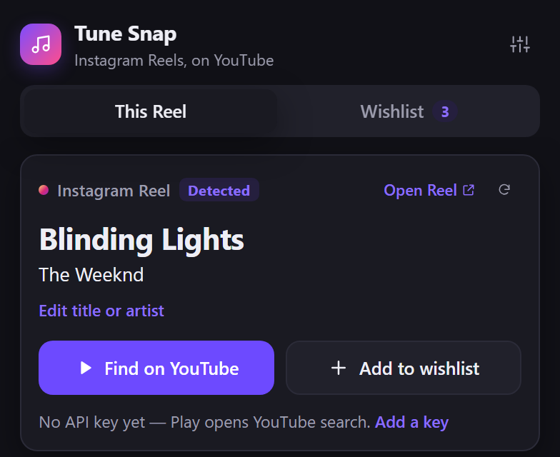
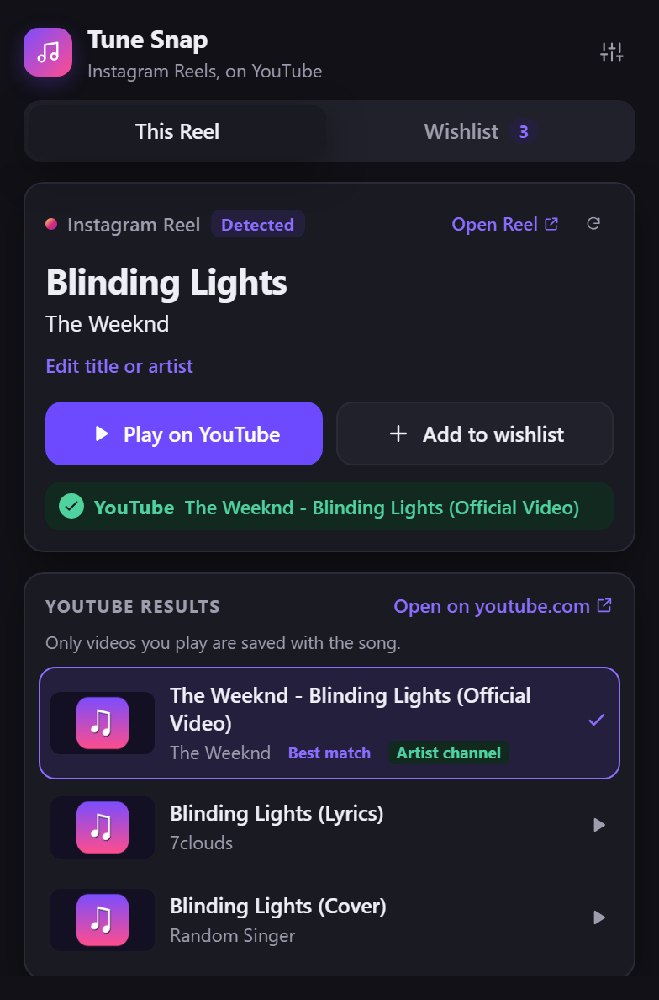
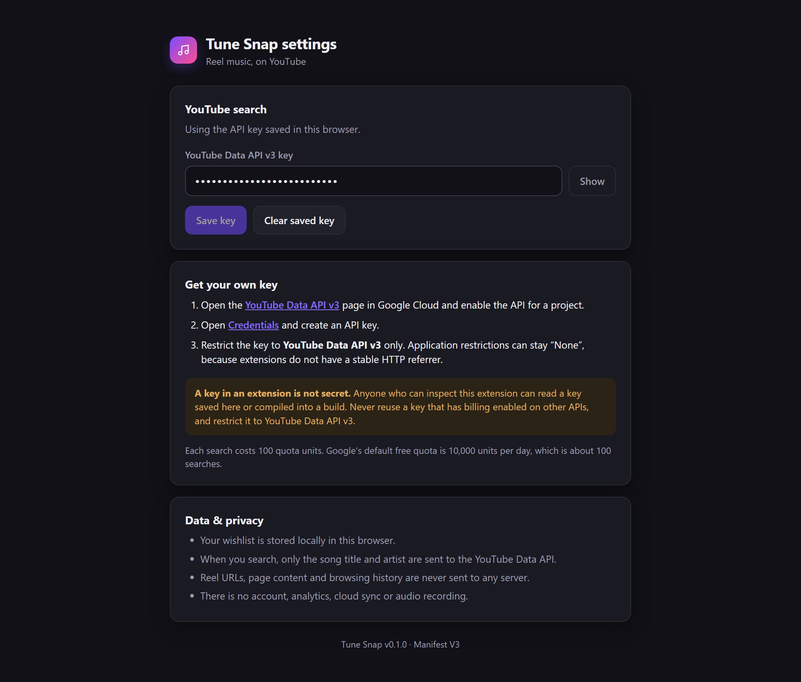
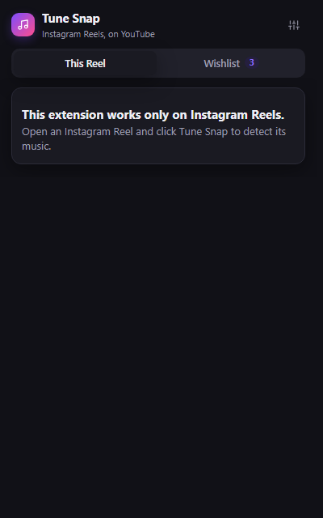
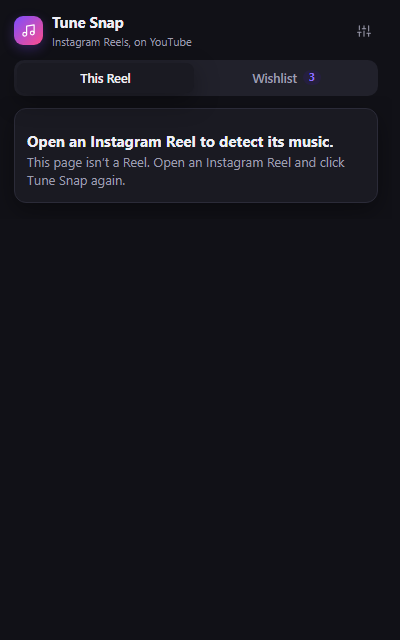

# Tune Snap

Tune Snap is a Chromium-based browser extension built with Manifest V3 for saving the song you hear
in an Instagram Reel, finding it on YouTube, and keeping a local wishlist — without leaving the Reel.

It is deliberately small: one popup, one content script, local storage, and a single YouTube
Data API call. No account, backend, analytics, audio recording, or fingerprinting.

<p>
  
  
</p>

## Status

Verified in this repository:

- `pnpm typecheck`, `pnpm test` (22 files, 212 tests), and `pnpm build` all pass.
- Popup and options layouts were rendered from the production build with mocked extension APIs
  (screenshots in this README; thumbnails are placeholders).
- Storage, duplicate detection, legacy-data recovery, metadata normalization, adapter parsing,
  active-Reel scoping, YouTube ranking, caching, and API error mapping are covered by unit tests.
- The **built content-script bundle** was executed in a live public Instagram Reel page through the
  DevTools Protocol (main-world probe, logged out). It detected `NEON · A2O, A2O LITE` with
  high confidence from `structured-music+audio-link` (score 1.0, 2 clusters). On a simulated SPA URL
  change, it cleared the old card and did not re-approve the old structured/link evidence; after the
  visible label changed it detected `Flowers · Miley Cyrus`. This validates the public logged-out
  Reel shell, not an authenticated Instagram feed.
- A second built-bundle probe **without a watcher port** (simulating a popup that was closed during
  navigation) returned `no-metadata` after the URL changed even though the old label/structured
  record was still mounted, then returned Flowers once the visible label changed. This is the
  popup-close/reopen path used by normal browser extension popups.
- See [PROJECT_DOCUMENTATION.md](PROJECT_DOCUMENTATION.md) for the root-cause analysis, every
  evidence source and weight, conflict resolution, and the audio-fingerprinting feasibility review.

Still requires a manual check on your machine:

- **Authenticated Instagram Reels.** Detection was verified only on one public logged-out Reel.
  Automatic detection remains best-effort, with the manual editor as the guaranteed fallback. See
  [Detection limitations](#detection-limitations).
- **A real YouTube Data API key.** Every network path is tested with mocked responses, but the
  Google CORS/quota behaviour has not been exercised against the live API here.

## Features

- Detects the track label on Instagram Reels only.
- Stacks page-structured music records, track links, accessibility metadata, visible labels, glyphs,
  and Media Session metadata; correlated signals are de-duplicated before scoring.
- Scopes labels to the visible/active video, ignoring hidden, offscreen, preloaded, or page-level
  music labels that belong to another Reel.
- Resolves conflicting evidence explicitly; two close candidates produce **“Couldn’t confirm the
  music”** instead of an arbitrary song.
- Shows title, artist, platform, Reel link, and whether the values were detected or edited.
- Manual title/artist entry with a swap control whenever detection fails or is ambiguous.
- Searches YouTube with **artist + title**, ranks results, and shows thumbnail, title, and channel.
- "Play on YouTube" opens the chosen video in a new tab; it never downloads, proxies, or rehosts
  audio.
- Saves songs to extension local storage, with search/filter, delete, and play-later.
- Duplicate detection based on normalized title + artist; remixes and versions are kept separate.
- Works without an API key: Play falls back to a YouTube search tab, and the wishlist keeps working.
- Handles missing API keys, invalid keys, quota exhaustion, network failures, and empty results.
- Caches equivalent searches for 6 hours in extension session storage to avoid repeat quota usage.

## Requirements

- Node.js 22 or newer (24 is used here)
- pnpm 11+ (tested with 11.28.5; `npm` works too, see
  [Package manager note](#package-manager-note))
- A Chromium-based browser with Manifest V3 support (the manifest retains a compatibility floor of
  110)

## Setup

```bash
pnpm install

# Optional: bake a default API key into the build
cp .env.example .env
# then edit .env and set WXT_YOUTUBE_API_KEY=...

pnpm dev        # launches a Chromium-based browser with the extension loaded
```

Or build and load it manually:

```bash
pnpm build
```

1. Open the browser's extension management page.
2. Enable **Developer mode**.
3. Choose **Load unpacked** and select `.output/tune-snap-mv3`.

The exact label and address of the extension-management page vary by browser. The production build
creates that MV3 directory under `.output`.

After every production rebuild, press **Reload** on Tune Snap and reload any open Instagram tab.
The content script and its popup-lifetime watcher are initialized on page load; an old tab keeps the
old script until reloaded.

You can also set the API key from the extension's **Settings** page (sliders icon in the popup),
which is useful for a build that should not contain a key.



### Scripts

| Command | Purpose |
| --- | --- |
| `pnpm dev` | WXT dev server with hot reload and a Chromium-based browser instance |
| `pnpm build` | Production Manifest V3 build in `.output/tune-snap-mv3` |
| `pnpm typecheck` | `tsc --noEmit` with strict mode |
| `pnpm test` | Vitest unit tests |
| `pnpm check` | Typecheck + tests + build |

## YouTube API key

The extension uses [YouTube Data API v3](https://developers.google.com/youtube/v3/docs/search/list)
`search.list` only.

1. Open the [YouTube Data API v3](https://console.cloud.google.com/apis/library/youtube.googleapis.com)
   page and enable it for a Google Cloud project.
2. Open [Credentials](https://console.cloud.google.com/apis/credentials) and create an API key.
3. Restrict the key to **YouTube Data API v3** only. Leave application restrictions at **None**;
   extensions have no stable HTTP referrer, so website restrictions will reject the extension.
4. Either paste the key into **Tune Snap Settings**, or set `WXT_YOUTUBE_API_KEY` in `.env` before
   building.

**The key is not a secret.** Anything compiled into a browser extension can be read by anyone who
can load or inspect it, and a key saved in Settings is stored in plain text in
extension local storage. Use a dedicated key, restrict it to the YouTube Data API, and never reuse a
key that has billing enabled on other APIs. Rotate it if it leaks.

**Quota:** each `search.list` call costs 100 units. Google's default free quota is 10,000 units per
day, which is about 100 searches. Tune Snap requests 6 results per search and reuses a cached result
for an equivalent title + artist for 6 hours.

Precedence: a key saved in Settings overrides the build-time key. If neither exists, Tune Snap still
saves and manages the wishlist; **Play** opens a YouTube search results tab instead.

## Using Tune Snap

1. Open an Instagram Reel on `www.instagram.com`.
2. Click the Tune Snap toolbar icon.
3. If the page exposes a music label, the popup shows the title and artist tagged **Detected**.
   Use **Edit title or artist** (or the swap control) to correct it.
4. Press **Play on YouTube**:
   - With a key, Tune Snap searches and either opens a confident match or shows the result list so
     you can choose. The chosen video is shown on the card before you save.
   - Without a key, it opens YouTube search for the same query.
5. Press **Add to wishlist**. Saving works even when YouTube is unreachable or unconfigured.
6. Open **Wishlist** to filter, play, or remove saved songs. The wishlist remains available on
   non-Instagram pages and on Instagram pages that are not Reels.

On any other website, the popup displays **“This extension works only on Instagram Reels.”** and
does not contact the page. On Instagram pages that are not Reels, it displays **“Open an Instagram
Reel to detect its music.”** and does not run detection.

<p>
  
  
</p>

These two states were rendered from the production popup build with a mocked active tab; the mock
would throw if the popup attempted a content-script request or port, and neither was called.

The Reel link is kept on the saved item, so you can jump back to the source later.

## How detection works

The content script answers a typed `GET_REEL_TRACK` message from the popup. If the page is still
rendering, it waits up to 1.8 s using a single **request-scoped MutationObserver** (120 ms throttle)
and disconnects as soon as it settles. There is no permanent DOM polling. Every evaluation reads the
live URL and document, so a previous Reel is never reused.

While the popup is open it also holds a lightweight port subscription. The content script watches
DOM/video/label changes **and checks the SPA Reel URL every 500 ms** plus on `popstate`/`hashchange`.
When the Reel identity changes it immediately invalidates the old card and suppresses the previous
label/structured record until the visible music DOM changes or a different track is found. The
watcher disconnects as soon as the popup closes.

Tab URL changes also trigger a popup refresh, with a one-second active-tab URL check as an SPA
fallback. Async responses are rejected when they belong to a Reel older than the active URL, so a
delayed result cannot overwrite the new Reel.

The content script keeps a page-lifetime Reel session across popup close/reopen. If the Reel changed
while the popup was closed, a fresh request rejects the previous track (and its still-mounted
label/structured record) and returns **“Music not detected”** until the new Reel's visible music
metadata changes or appears. One watcher/observer is kept per page; duplicate ports are stopped.

The popup disables Play/Add and clears the previous draft, search results, and selected video while
a read is in flight.

### Evidence layers

The Instagram adapter feeds the weighted engine in [`lib/detection/`](lib/detection/):

| Evidence | Examples / platform use |
| --- | --- |
| Structured music records | Embedded `music_asset_info` (`title`, `display_artist`, `audio_cluster_id`), matched to the current Reel/audio id. |
| Track links | Instagram `/reels/audio/` links; link text plus its own `aria-label`/`title`. |
| Accessibility metadata | `aria-label`, `title`, `aria-description`, music-oriented `data-testid`, `data-audio-title`, `data-song-title`, `data-track-title`, `img[alt]`. |
| Visible labels | Short song/artist text in the Reel shell even without a link or glyph. |
| Music-note text | `♫`/`♪` marquee/label fallback. |
| Media Session | `navigator.mediaSession.metadata`, used only as weak corroboration. |

Caption/`og:` text is used only to check consistency with a candidate, never as the sole detection.

### Scoring, correlation and conflicts

Source reliability starts at 0.92 for a current-Reel structured record, 0.86 for an explicit track
link, 0.62–0.68 for accessible/visible labels, and 0.40 for Media Session. The effective score is
`sourceWeight × (0.55 + 0.45 × reelContext)`. Independent source families add at most 0.12; caption
consistency adds at most 0.05. Correlated link+aria-label+ancestor text is merged so it is counted
once. The full weights and thresholds are in
[PROJECT_DOCUMENTATION.md](PROJECT_DOCUMENTATION.md#4-evidence-scoring-transparent-weighted-ensemble).

- Title/artist pairs are grouped **order-insensitively**, so `Artist · Song` and `Song · Artist`
  corroborate; a weighted vote selects the output order.
- High confidence requires a strong source, sufficient margin, and strong Reel context.
- Two strong but conflicting songs produce **“Couldn’t confirm the music”**, not a guess.
- Remix/live/sped-up versions remain distinct and are never merged with the original.
- A strong current “Original audio” label is not overridden by a weaker neighbouring song.

### Reel context

[`lib/adapters/layout.ts`](lib/adapters/layout.ts) grades context instead of hard-rejecting:

1. Find the active `<video>` — visible, largest, most centred, preferably playing.
2. Hidden, offscreen, zero-sized, or `aria-hidden` elements score zero.
3. Labels in the active video's nearest container score highest; labels near it, in a visible
   dialog/article/main, or in a shared feed containing several videos score lower.
4. If no video is visible, a visible dialog/article/main can still provide context.

Structured records are only trusted strongly when their audio id or nearby Reel code matches the
current URL. This is what prevents a preloaded Reel's data from replacing the current one.

### Text normalization and order

Text is normalized (zero-width characters, whitespace, note glyphs, `Audio:` prefixes), then split
on `·`, `•`, `・`, `|`, `–`, `—`, or `-`. The default is **title first, artist second**. When the
first part is a comma-separated artist list and the second is not, the order is inferred as
artist-first; structured data always wins when available. The swap control remains for ambiguous
single-artist labels. “Original audio” is surfaced as such rather than turned into a fake song.

### Detection limitations

- Instagram changes its DOM regularly, and Reels layouts differ by account, locale, experiment, and
  logged-in state. **Automatic detection is not guaranteed on every Reel.**
- The authenticated Instagram feed was not available in this environment. Detection was verified on
  one public logged-out Reel shell only.
- Only `https://www.instagram.com/*` is covered (no `m.` or bare-domain hosts). Other websites never
  receive a content script, are not read, and show the Instagram-only popup message.
- Content scripts are injected on page load. If you installed or reloaded the extension while a
  Reel was already open, reload the Reel tab once.
- Labels inside a shadow root or a separate document root that cannot be related to the active Reel
  produce **“Music not detected”** rather than a page-wide guess. Detected values are always
  editable.
- A single-artist artist-first label without a comma (`A2O•NEON`) is order-ambiguous; use Swap.
- No authentication is bypassed, and private or restricted pages are not accessed.
- Audio fingerprinting is not included: there is no free, complete, browser-local song database,
  and the practical recognition services are paid/account-based. Tune Snap does not capture or
  upload audio. See [PROJECT_DOCUMENTATION.md](PROJECT_DOCUMENTATION.md#35-audio-fingerprinting--evaluated-and-not-implemented).

## Architecture

```
entrypoints/
  content.ts                 Content script: answers detection requests, no UI
  popup/
    index.html, main.tsx
    App.tsx                  State orchestration for capture + wishlist
    draft.ts                 Detection result -> editable draft (pure, tested)
    components/              Capture, SongForm, SearchResults, WishlistView, Header, Notice, Icon
    hooks/                   useReelDetection, useWishlist
  options/                   API-key settings page
lib/
  adapters/                  Instagram adapter, parsing, Reel context geometry
                             (layout.ts: visibility, active video, context grading)
  detection/                 Evidence types, source weights, DOM/structured collectors, weighted
                             engine with correlation and conflict resolution
  storage/                   StorageArea abstraction, wishlist repository, settings
  youtube/                   API client, ranking/confidence, session cache, search service
  types/                     Song, wishlist, and YouTube domain types
  utils/                     Text normalization, identity, time, error helpers
  messaging.ts               Typed request/response guards between popup and content script
  wishlist-filter.ts
assets/theme.css             Shared design tokens
test/fakeArea.ts             In-memory StorageArea for tests
public/icon/                 Generated extension icons
scripts/generate-icons.py    Optional icon generator (Pillow)
```

Key decisions:

- **No background service worker.** Search runs in the popup, and the popup has no lifecycle state
  to lose. Session storage keeps the search cache across popup opens without a long-running process.
- **Content script is a data source only.** Nothing is drawn over Instagram.
- **Storage and platform logic are framework-free.** React components only render state; all
  persistence and parsing live in `lib/` and are unit tested.
- **Page data is untrusted.** Messages are validated field by field, React escapes all text, and
  there is no `innerHTML`, `eval`, or remote code.

## Data model

```ts
interface WishlistItem {
  id: string;                 // stable UUID
  title: string;
  artist: string | null;
  source: 'instagram' | 'manual';
  reelUrl: string | null;
  metadataOrigin: 'detected' | 'manual' | 'edited';
  createdAt: number;
  updatedAt: number;
  video: SavedVideo | null;   // only after the user played/picked a match
}

interface WishlistDatabase {
  schemaVersion: 1;
  items: WishlistItem[];
}
```

Stored under `reeltune.wishlist.v1` in extension local storage (the `reeltune.*` storage keys and
the internal `reeltune-reel-watch` port name are intentionally retained so existing
wishlists/settings keep working after the Tune Snap rename). Loading tolerates:

- the current envelope,
- a bare legacy array or a single item object,
- stringified JSON,
- missing optional fields and invalid entries (dropped, never crashing the popup),
- duplicate ids or duplicate song identities already in storage.

**Duplicate identity** is `normalizeForIdentity(title) + "|" + normalizeForIdentity(artist)`:
case, accents, punctuation, and upload decorations such as "(Official Video)" or "[Lyrics]" are
ignored, while version words ("remix", "live", "acoustic", "sped up", …) are preserved. Two
different versions therefore never collapse, and the same song saved from multiple Reels is reported
as a duplicate. If the existing item has no YouTube match yet and the new save does, the match is
attached to the existing item instead of creating a second row.

The stable `id`, the saved `video.videoId`, `updatedAt`, and the versioned envelope are the hooks a
future playlist sync needs; no schema redesign is required.

## Permissions

| Permission | Why | Scope |
| --- | --- | --- |
| `storage` | Wishlist, settings, 6-hour search cache | Extension-local only |
| `activeTab` | Read the active tab's URL after the toolbar icon is clicked, to decide whether the page is supported | Only the tab the user acted on |
| `host_permissions: https://www.instagram.com/*` | Inject the detection content script | Instagram only |

There is no `tabs` permission, no history access, no `<all_urls>`, and no host permission for
Google APIs (the request relies on Google's CORS headers). The manifest retains a compatibility
floor of 110 for the newest APIs used (`storage.session` and `AbortSignal.timeout`).

## Privacy and security

- The wishlist never leaves the browser; there is no account, sync, analytics, or telemetry.
- A Reel URL, page content, and browsing history are never sent anywhere.
- When the user presses Play, the YouTube request contains the song title and artist (as `q`), the
  selected response fields, and the API key. No Reel URL or account data is included.
- Video thumbnails are loaded directly from `i.ytimg.com`.
- Page-derived strings are treated as untrusted input: messages are validated, URLs must be
  `http(s)`, and video ids must match YouTube's id shape.
- API keys are observable by design; see [YouTube API key](#youtube-api-key).

## Tests

```bash
pnpm typecheck
pnpm test
```

The suite covers:

| Area | Tests |
| --- | --- |
| Metadata normalization and identity | whitespace, accents, punctuation, decorations, version separation |
| Song-line parsing | note glyphs, labels, separators, "original audio", UI noise, confidence |
| Instagram adapter and registry | Reel/audio URL canonicalization, graceful misses, non-Instagram rejection |
| Instagram-only routing | arbitrary hosts return unsupported without page reading; Instagram non-Reel detection is blocked |
| Popup messages | exact unsupported-site and non-Reel messages, no detection form on blocked states |
| Structured music data | current vs. preloaded audio-id/Reel-code matches, malformed/duplicate records |
| Evidence engine | source weighting, correlated link+aria de-duplication, title/artist order voting, strong-vs-weak conflicts, original-audio precedence |
| Reel context and stale data | hidden/offscreen/preloaded/shared-feed labels, page-level players, deep nesting, DOM replacement |
| Delayed rendering / navigation | request-scoped MutationObserver, timeout, URL change during wait |
| Live watch | popup-lifetime port, label/Reel changes, cleanup on stop, signature change detection |
| Production lifecycle | URL-only SPA change, DOM-before-URL change, old structured record suppression, repeated same Reel, stale response rejection |
| Reel session | page-lifetime stale guard across popup close/reopen, new-track/same-song-new-link acceptance, missing metadata |
| Wishlist storage | add/load/remove, dedupe, video attachment, legacy migration, malformed data, read/write failures |
| Settings | trimming, precedence, malformed values, storage failure |
| YouTube client | request shape, parsing, thumbnail fallback, quota/key/HTTP/network/timeout mapping |
| Ranking | artist uploads over lyrics/covers, version intent, confidence, dedupe |
| Cache and service | TTL, equivalent keys, eviction, cache-hit without network, failure isolation |
| UI helpers | draft mapping, edit origin, filtering, relative timestamps, message guards |

### Manual test checklist

These need a real browser session and, for some, real credentials:

- [ ] Load `.output/tune-snap-mv3` unpacked. On a non-Instagram website,
      confirm the exact message
      **“This extension works only on Instagram Reels.”** and that no page read/detection occurs.
- [ ] On an Instagram page that is not a Reel, confirm
      **“Open an Instagram Reel to detect its music.”**
- [ ] Open an Instagram Reel with licensed music; confirm the detected title/artist and Reel link.
- [ ] Open Reel A, note its song, close the popup, navigate to Reel B, and reopen. Confirm B is
      detected; A's title must not remain. (Browser extension popups close when you click the page,
      so this is the normal multi-Reel check.) Repeat with the production build in
      `.output/tune-snap-mv3`.
- [ ] If using an environment where the popup stays open, navigate to B in the page and confirm the
      old card clears and B appears without reopening.
- [ ] Navigate to a Reel with no music label; confirm **“Music not detected”**, not the previous song.
- [ ] Open a Reel with "Original audio"; confirm it is reported honestly, not invented.
- [ ] Use **Edit title or artist** and **Swap title / artist**; confirm the tag changes to "Edited".
- [ ] If a label arrives artist-first without a comma, use Swap and confirm search still works.
- [ ] Search with a real API key; confirm results, thumbnails, channels, and that the chosen video
      opens in a new tab.
- [ ] Try an invalid key and an exhausted quota; confirm the messages and the YouTube-search
      fallback without breaking the wishlist.
- [ ] Add a song, close and reopen the popup, restart the browser, and confirm the item persists.
- [ ] Save the same song twice with different casing; confirm "already in your wishlist".
- [ ] Save a remix and the original; confirm both are kept.
- [ ] Filter the wishlist, play a saved item, delete an item, and confirm the count updates.
- [ ] Install/reload the extension while a Reel is open; confirm the reload hint appears.
- [ ] Save a title containing ``; confirm it renders as text.

## Limitations

- Authenticated Instagram detection is unverified; it was verified on one public logged-out Reel
  shell. Automatic detection remains best-effort, with manual editing as the fallback.
- Actual click-through navigation across multiple authenticated Instagram Reels has not been
  verified here; the SPA lifecycle is covered by regression tests and a simulated URL/DOM change on
  a public Reel page.
- If a new Reel uses the exact same song and only a preloaded plain-text label with no changed
  visible audio link, the stale guard may show “Music not detected” until the label changes. This is
  safer than showing the previous Reel's song.
- Only desktop `www.instagram.com` is supported; mobile web (`m.instagram.com`) and app deep links
  are not.
- Playlist writing, accounts, cloud sync, audio recognition, and monetization are explicitly out of
  scope for this MVP.
- Results are search-based; YouTube's search ranking can still surface the wrong version, which is
  why uncertain matches are never auto-saved.
- The 6-hour cache uses extension session storage; it disappears when the browser closes and is
  bounded to 25 queries.

## Optional later phase: YouTube playlist sync

Adding a video to a user's private YouTube playlist needs **Google OAuth 2.0 with the
`https://www.googleapis.com/auth/youtube` scope**; an API key only identifies the extension and
cannot write to a user's account. A correct implementation would need:

1. The extension identity flow (`launchWebAuthFlow` or `getAuthToken`) with the `youtube` scope.
2. A Google Cloud OAuth client (extension type) and consent-screen verification for that sensitive
   scope.
3. Access/refresh token storage and refresh handling, plus a revoke/disconnect path.
4. Playlist creation (one `playlists.insert`, then `playlistItems.insert` per song, each costing
   quota) and a visible sync status per item.

The current model already has what that needs: stable `id`, `video.videoId`, timestamps, and a
`schemaVersion` to add fields such as `playlistItemId` or a per-account sync table. None of it is
implemented here.

## Package manager note

`pnpm-workspace.yaml` sets `nodeLinker: hoisted`. pnpm 11 no longer reads non-auth settings from
`.npmrc`, and its default isolated linker on Windows/Node 24 produced junctions that Node's ESM
loader could not resolve in this environment. The hoisted layout is equivalent for this project.
`npm install` also works, though the lockfile is pnpm's.

## Icons

`scripts/generate-icons.py` rasterizes `public/icon/{16,32,48,128}.png`. It is optional (the icons
are committed) and expects Pillow plus the Windows `seguisym.ttf` font.

